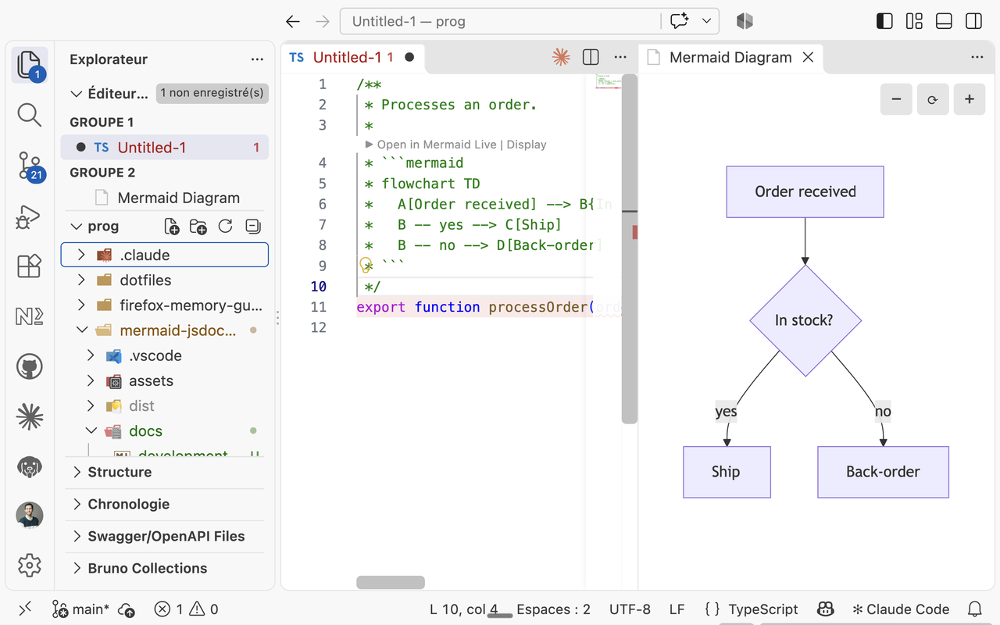

# Mermaid JSDoc Viewer

A VS Code extension that previews the ` ```mermaid ` diagrams written in your
JSDoc comments and Markdown files, or opens them in the [Mermaid Live](https://mermaid.live)
editor, straight from the code.



## Installation

Download the `.vsix` of the
[latest release](https://github.com/g-ongenae/mermaid-jsdoc-viewer/releases/latest)
and install it:

```bash
code --install-extension mermaid-jsdoc-viewer-<version>.vsix
```

## Documentation

- [Usage](docs/usage.md): the CodeLenses, the commands and how a diagram reaches
  mermaid.live.
- [Development](docs/development.md): building, debugging and packaging the
  extension.

## License

[MIT](LICENSE)
